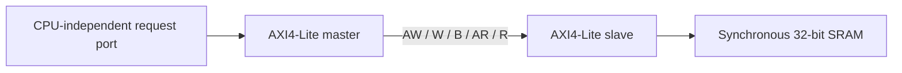

# AXI4-Lite Master/Slave Memory Interface — RTL and Verification

A standalone, CPU-independent 32-bit AXI4-Lite memory path extracted from [riscv-axi-soc](https://github.com/rouhan28may-droid/riscv-axi-soc) at commit `ceacccb687b39af045431f2ce4d1205276780b6a`. The original interface, master, slave, and SRAM are preserved byte for byte. This repository adds a small integration top, independent directed harnesses, launchers, and evidence. It is an educational bounded implementation, not a full AXI4 or UVM product.



## Quick start

From this repository root on Windows, with `vlib`, `vlog`, and `vsim` from ModelSim Intel FPGA Starter Edition 2020.1 on PATH:

```powershell
powershell.exe -NoProfile -ExecutionPolicy Bypass -File scripts/run_regression.ps1 -OutputDir run-output
```

The launcher refuses to overwrite an existing output directory. Supply a new `-OutputDir` for each rerun. It compiles the minimal ordered files in `sim/rtl.f` and `sim/testbenches.f`, runs seven self-checking tops, checks `$finish` and pass markers, and exits nonzero on a compile, elaboration, simulation, or log failure. Raw logs for the validated local run are in `reports/validation-2026-11-05/`. [Results](docs/RESULTS.md) give the exact tested version, command, counts, and limitations.

For WSL/Linux, `bash sim/run.sh /path/to/new-output` is the shell entry point when a compatible ModelSim/Questa installation provides `vlib`, `vlog`, and `vsim` on PATH. The launcher passed `bash -n` in WSL, but the WSL environment here lacks those simulator executables, so its full regression has not run. The PowerShell path above is the validated path.

## Design scope

- One shared clock, synchronous active-low reset, 32-bit data/address, and one outstanding master request.
- Master emits AW/W together but independently holds each until accepted. The slave can accept AW and W in either order and keeps B/R responses stable during backpressure.
- Byte-lane writes support all 16 WSTRB values. The default SRAM is 1,024 words at `0x10000000`; misaligned/out-of-range requests return SLVERR. SRAM contents are uninitialized at power-up and retained across reset.
- The new `axi4_lite_memory_top` connects the copied master, slave, and SRAM behind a simple request/completion interface. Direct slave and controlled-responder tests exercise behavior that the integrated master traffic alone would miss.

See [specification](docs/SPECIFICATION.md), [test plan](docs/TEST_PLAN.md), [results](docs/RESULTS.md), and [provenance](docs/PROVENANCE.md). The original SoC's three AXI tests, SRAM test, helper modules, and historical logs are preserved under `tb/legacy/` and `historical_logs/`. No processor or SoC file list is copied into the standalone build. `LICENSE_STATUS.md` describes the source licensing state.

## Limits

This project does not implement bursts, DMA, a CPU, an interconnect, UVM, or new arbitration features. No licensed randomization, covergroup, or concurrent assertion execution is required by the portable regression. The tested results do not establish full AXI4-Lite compliance, coverage closure, synthesis, timing closure, or hardware operation. The source SRAM and master have no hardware timeout; the testbench timeout is an environment guard.
